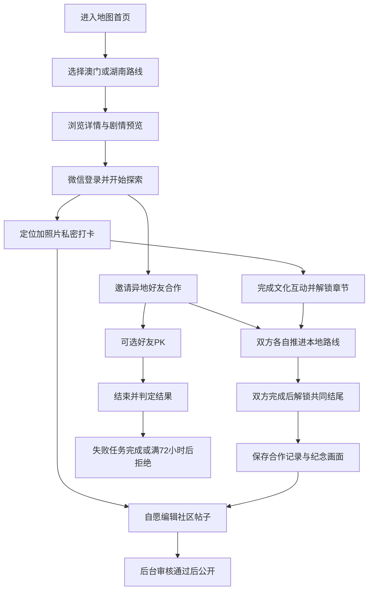

# 非遗云想微信小程序首版设计

日期：2026-11-10；最后确认：2026-11-11。状态：用户已确认整体设计，并补充点位图标恢复旧样式；进入开发计划阶段，业务尚未实现。产品工作名“非遗云想”，主线主题“海丝瓷绣”，剧情《海丝瓷绣·一念归期》，角色“澳喵”。

本文覆盖微信小程序、管理后台、云端业务及验收边界。已确认需求与设计者补充的默认规则分别标注。当前界面草图在 [旧版地图首页复用方案](../../design/2026-11-11-map-home-design.html)，素材清单在 `2026-11-10-asset-reuse.md`。2026-11-10 的四入口草图归档，仅作历史参考。

2026-11-11 最新确认：用户明确要求保留旧版大地图首页、左右两侧页面跳转按钮，底部不使用 Tab 栏。原四主入口导航方案被替代；以地图为首页、侧边入口跳转二级页面。旧客户端已运行并接通隔离的本地演示数据，详见 [旧版复用评估](../../design/2026-11-11-legacy-reuse-review.md)。档案、路线、详情、社区与个人页优先沿用旧版结构。

## 1 用户已确认的范围

- 作为新软件开发，不迁移旧用户、打卡、照片、剧情或奖励数据。
- 面向微信小程序，使用 uni-app 技术体系与 uniCloud；管理端同步重新设计。
- 路线驱动、剧情贯穿；首批内容为澳门博物馆和湖南湘绣博物馆。馆名为工作名称，正式馆名、位置与实际展品须由内容资料核实。
- 使用旧工程 `app/static/pet/wave.png` 澳喵图片，不制作其他角色模型、3D 或 VR；首页按钮可复用旧图片。
- 首页保留旧版大地图和左右跳转按钮，不使用底部 Tab；最新修订将侧边按钮缩小、删除中央圆形按钮。底部当前路线条默认收起，点击展开当前任务及打卡入口。
- 两地好友分别参与当地路线、合作完成目标；首版仅好友邀请组队。
- PK 是可选玩法，先做简单完成用时比较；失败任务满三天后可拒绝，任务结束后可再次 PK。
- 打卡用定位和照片判定；凭证默认私密；用户可自行选择生成社区帖子。
- 帖子提交和修改后需后台审核通过才公开；评论采用词库与防刷屏检查，并保留后台治理。
- 删除步数、步数排名、金币、商城、道具、抽奖、电子宠物养成消费系统；不继承原校园功能。
- AI 猜图保留入口，暂不实现。邮箱、学生认证、展品识别和打卡人工审核放后期。商业转化保留方向，首版不设计交易流程。

## 2 目标与方案选择

成功体验：用户能选当地路线、邀请异地好友、完成定位拍照与文化互动、看见双方进度、共同解锁结尾；愿意分享时经过审核进入社区。单人也能探索当地路线，不以找到异地好友作为全部体验的前置条件。

已讨论两种方案：路线驱动让线下目标、合作、PK 更直接；剧情驱动更沉浸，但依赖更多素材且需要处理无法到馆的阻断。用户已选择路线驱动。故事预览帮助理解动机，实际探索负责解锁，社区承接分享，澳喵承担引导。

首版不承担陌生人匹配、即时私聊、AI 生成、实时同屏、动态路线生成、多角色养成、商业交易及多端 App 发行。旧 AI 路线规划也不作为首版功能继承；新路线由后台编辑发布（设计默认）。

本次只形成设计和展示用草图，不写产品代码、安装依赖、改变云绑定、上传资源或初始化 Git。

## 3 已有工程事实

工作目录：`C:/Users/Raymond/Desktop/feinibuke/feiyiyunxiang`。用户指定远程：`git@github.com:luochiioi/feiyiyunxiang.git`；本次未连接或推送。

`app/` 和 `admin/` 均为用户创建的 uni-app x 初始项目（App.uvue、main.uts），目前都只有初始页面。设计沿用这个基础，不另行创建工程。用户端仅验收微信小程序；管理端目标是桌面浏览器 Web 运营后台（设计默认），不要求做成第二个小程序。

两端均出现 `uniCloud-alipay/`，用户说明已经关联服务。本次没有验证实际空间 ID、权限或是否关联同一环境，也不会将其替换成旧工程的 aliyun。云提供商选择与客户端发布微信平台是两个不同问题。

用户端 manifest 的 mp-weixin.appid 仍为空；DCloud AppID 已存在，它不等于微信小程序 AppID。微信登录联调时再获取正确配置。密钥仅在云端受控配置中使用。

云端源码唯一来源拟为 `app/uniCloud-alipay/`；管理端调用同一套业务服务。admin 现有云目录先保持原样，不维护第二套不同版本业务副本；共享或部署方式在实现阶段结合工具与实际关联确认。必须核实云提供商的事务、唯一索引、存储访问与鉴权依赖能力。

## 4 小程序结构与页面

地图是唯一首页。沿用旧版全屏地图和两侧澳喵按钮；删除地图中央的圆形按钮，打卡入口放在当前任务和点位详情中。全局不配置 tabBar、不设置固定底部导航，不使用 switchTab 作为页面切换方式。二级页沿用旧版页头返回；从通知、分享或登录进入而无可返回首页时，提供“回到地图”。

左右按钮初始位置为设计默认：左侧“我的、社区、剧情”；右侧“旅伴、路线”，以及缩放与定位控件。跳转按钮草图由 55×66 缩至 46×55，图标由约 38 缩至 30，保留文字；正式实现按逻辑像素核对触控区域，不能仅缩小可点击范围。旅伴内承载好友、合作和可选 PK；排行整合在社区，不占首页独立位置。移除旧校园、宠物养成、步数和金币入口。按钮避开微信胶囊、安全区和底部当前路线条。

底部默认仅显示约 50 高的当前路线条：路线名、完成进度、展开提示。点击展开，才展示下一项任务、去打卡和合作进度；可再收起。未选路线时隐藏底部条，由右侧“路线”选择。右侧入口打开路线列表，底部展开的是当前选中路线的任务，二者不重复跳转到同一列表；展开卡中的“去打卡”进入当前任务，点位详情也有打卡入口。该条不是 Tab，不恢复步数/金币面板。默认收起是本次对用户所提两种方式的推荐设计。

地图优先呈现选中路线的真实定位节点；先选澳门/湖南本地路线，再继续探索，满足“路线驱动”。首次未选路线时显示地区/路线选择提示；定位拒绝时仍可手动查看路线。二级页返回保留路线、选中点位与地图视野，不因每次返回重新定位。

点位图标按用户最新要求复用旧版澳喵图钉：未打卡 `marker_default.png`（灰色）、已打卡 `marker_checked.png`（彩色）；选中时沿用 `marker_default_selected.png` / `marker_checked_selected.png`。草图恢复两种常规状态，不使用数字水滴替代原样式。定位节点显示状态来自本次探索记录，不把不同用户的打卡状态混在一起。

| 页面 | 核心内容与主要操作 | 状态与边界 |
| --- | --- | --- |
| 地图首页 | 全屏地图、缩小的左右入口、地区/路线选择、默认收起的当前路线条 | 无底部 Tab、无中央圆形按钮；展开后显示任务和打卡入口，未选路线隐藏底部条 |
| 路线详情 | 馆方信息、路线说明、任务顺序、预计体验、地图入口、开始/继续、邀请好友 | 未发布/暂停路线不可开始；不编造开放时间和票务信息 |
| 路线地图 | 复用首页地图并切换到本路线聚焦模式，展示节点、当前位置、详情、打卡 | 不重复建设第二套地图壳；室内定位按配置容差验证 |
| 点位与打卡 | 任务要求、获取定位、拍照/选图、私密提示、提交 | 拒绝定位可重试或浏览；上传中防重复提交 |
| 打卡完成/详情 | 本次记录、下一任务、已解锁内容、发布到社区 | 不默认公开，不向好友展示原始凭证 |
| 文化互动 | 瓷砖图案配色、湘绣辨认、学习卡片 | 支持重试、保存与退出恢复，不加入金币奖励 |
| 剧情目录/阅读 | 六幕摘要、已解锁章节、图片对白、选择、继续阅读 | 预览开放；正式章节按本地路线门槛解锁 |
| 旅伴页面 | 从地图右侧进入；好友、待处理邀请、当前合作、PK 与任务入口 | 二级页面，返回地图；首版无陌生人匹配与私聊 |
| 好友列表/申请 | 用户公开编号查找、申请、接受/拒绝、解除好友 | 不上传微信通讯录；不可仅凭昵称自动加好友 |
| 合作邀请/详情 | 双方身份与城市、接受邀请、两端任务进度、共同目标 | 只展示完成状态，双方无需同时在线 |
| PK 邀请/详情 | 路线、规则、双方准备、服务器计时、完成结果 | 开始后规则固定；待处理失败任务者不能再参赛 |
| PK 后任务 | 指定任务、完成入口、拒绝解锁倒计时 | 72 小时后开放拒绝；不是满时自动拒绝 |
| 合作成果 | 共同结尾、双人纪念画面、完成日期、保存/发布 | 无道具背包；对外成果、保存图片与社区导入均匿名化另一方 |
| 社区首页 | 最新帖子、好友内容、好友排行入口、发布 | 只读已审核内容；没有步数排名 |
| 帖子详情 | 正文图片、点赞收藏、评论、分享、举报 | 作者查看自己的审核状态；被下架内容不继续公开 |
| 发帖/编辑 | 文字图片、可选关联路线、提交审核、草稿 | 从打卡导入时明确选择哪些图片；修改产生新版本 |
| 我的 | 澳喵形象、资料、打卡日记、文化作品、合作记录、我的帖子、消息、设置 | 无余额、步数、学生认证或邮箱强制门槛 |
| 日记/作品 | 私有打卡记录、笔记、瓷砖作品、纪念画面 | 删日记不删除已经独立审核发布的帖子 |
| 消息中心 | 好友与合作邀请、PK 结果、审核结果、系统通知 | 首版站内通知；不依赖常驻弹幕或 App 推送 |
| 微信登录/设置/协议 | 微信登录、头像昵称设置、退出、协议、隐私和账号处理入口 | 不把微信登录等同于自动获得头像昵称或手机号 |
| AI 猜图入口 | 说明“敬请期待” | 无上传、扣费、虚假生成进度或假结果 |

游客可浏览已发布路线、剧情预览与公开社区。开始记录进度、加好友、合作、PK、发布与互动时登录；登录成功后回到原操作，失效会话不丢草稿。

## 5 主要使用流程

## 6 路线与打卡规则

设计默认：每个已发布路线版本定义有序节点；节点类型为定位照片、DIY、答题、学习、剧情。必须节点完成后才能完成本次路线。地图只为带真实坐标的节点显示标记，科普节点不伪造现实地点。

路线选择与真实所在地分开。用户可以预览两地内容；在对应馆附近才可完成定位节点。首版具体坐标、半径、实拍要求与任务数量等待素材核实，不用虚构坐标形成可发布内容。开发用测试内容必须醒目标为测试且只存在开发环境。

每次正式探索产生 route_run，绑定用户、路线已发布版本和用途（单人、合作、PK）。同一 run 的同一节点只完成一次，重复 requestId 返回同一结果。PK 和新合作要求自己的新 run，不用历史完成记录直接结算；历史日记保留。

打卡提交：服务端从令牌取身份，检查 run、节点和上传归属；强制校验经纬度为有效有限数值及范围，计算距离，检查后台半径，保存服务端提交时间。缺定位不可成功；前端传入“距离合格”不作依据。

照片需上传成功并通过文件格式/大小限制，绑定所属用户和本次提交。首版支持拍照和选择图片，不宣称识别了展品或证明拍摄时间，定位也不能完全防伪造。自动识别及人工打卡审核不在首版。

上传失败可重试；断网仅保存本地草稿，不能显示成功或补写离线时间。客户端页面倒计时不是服务端事实。前台按操作取定位，不设计后台持续定位。

## 7 好友合作

设计默认：每队两人，澳门席位与湖南席位各一；身份来自本次选择的路线，不收集户籍。邀请仅对已建立好友关系者生效；每人最多一个进行中的合作队，邀请 24 小时未接受失效。

状态：邀请中 → 进行中 → 已完成；邀请可拒绝/撤回，进行中可退出并结束该队。退出不抹除对方个人记录；双方收到通知。无需强行等待同伴完成才允许个人继续阅读本地已解锁剧情。

发起时固定两条路线版本、必需节点、文化任务和成果模板；双方各自产生新 run。双方完成本地节点、相应文化任务且已提交作品后，服务端只生成一次合作成果。

成果采用镜头 41 的瓷砖与湘绣并置作为基础：双人完成记录、固定湘绣主题画面、澳门方瓷砖作品、共同结尾。纪念画面没有兑换/交易/数值属性。

登录后的合作详情可看双方公开昵称头像；首版对外成果页、保存的纪念图、社区导入和分享载荷统一匿名化另一方，只显示本人及“澳门旅伴/湖南旅伴”，不提供公开对方身份的开关。因此不产生含对方身份的公开纪念图片及后续撤回问题。私密打卡照片始终不自动进入成果。

## 8 PK 和三天任务

以下细则是为可实施而补充的设计默认，可在审阅时调整；不引入复杂路线公平换算。

- PK 与合作独立，可与同一好友发起；每人同时最多一局活跃 PK。合作不是参加 PK 的强制前置条件。
- 邀请说明双方各自的路线、节点与规则。接受后进入准备；双方明确就绪时由云端写入唯一 startedAt，同一时间起算。邀请/准备满 24 小时未开始可取消失效，不产生失败任务。
- 开局创建专用新 run。PK 终点要求完成该路线全部定位照片节点；剧情阅读、DIY、答题不纳入速度结算，合作的文化任务仍另行完成。避免强迫玩家跳过科普或因停留阅读被惩罚。
- 第一位有效完成全部目标节点者，在同一原子结算中将本局从进行中改为结束并获胜；立即为另一方分配失败任务，释放胜者占位。用服务端完成时间减 startedAt 展示用时；并发以云端首次成功提交的结算为准，首版不设置毫秒平局。失败任务的 72 小时从这次分配开始。首版不校正两条路线的客观长度差异，邀请明确显示规则。
- 开始后局最长 24 小时；到期仍无人完成，则本局结束且不分配失败任务。主动认输也可结束并产生本人的失败任务。被后台因路线关闭终止的局不产生任务。结束后败方的原探索 run 可继续完成并保存个人日记，但不能改变本局结果，也不能抵扣新分配的失败任务。
- 失败任务来自后台已发布的固定模板，不允许好友随意指定地点/内容。模板必须包含目标点、完成方式和安全可达的选择；可包含当事人可选的本地任务，不要求跨地旅行。
- 唯一 assignment 创建时记录 assignedAt 与 rejectAvailableAt = assignedAt + 72 小时。可立即开始并完成；满 72 小时开放“拒绝任务”，不自动拒绝，不另设三天自动到期。
- 失败任务 pending/doing 时，该用户不可创建、接受或进入下一局 PK；完成或拒绝后解除。胜者，以及无人完成到期或管理员无责终止后的双方不受此限制。合作、日记、社区和普通路线不被锁住。
- 首版失败任务只要求完成指定定位照片节点，不增加复杂时间段约束。合作/PK 的旧照片不自动抵扣。
- 提醒只存在任务页和非阻塞站内提示，可关闭本次提示；不实现跨页面持续弹幕或反复强制弹窗。具体时间到达后重新进入或刷新即可显示拒绝按钮，不依赖定时推送。

任务目标临时无法访问时，管理员可说明原因取消任务并解锁用户；保留日志，不把原记录改成“用户完成”。

## 9 剧情与文化任务

原脚本六幕 41 镜头是单人叙事，提供科普、DIY 和结尾画面；两地好友分工和双人终章为本设计扩展，不冒称原文已有。

| 原稿幕次 | 线上呈现 | 首版解锁建议 |
| --- | --- | --- |
| 一 触碰海丝地图 | 公共开场预览，图片对白及点击选择 | 游客可预览 |
| 二 海上风暴 | 保护瓷砖的叙事过场，弱化剧烈晃动 | 澳门路线首个定位节点完成 |
| 三 女儿与瓷砖 | 工序图文、瓷砖图案/蓝白配色 DIY | 澳门路线文化节点；DIY 保存后标记本地任务完成 |
| 四 澳门靠岸 | 渔村与文化交流过场 | 澳门路线后续门槛，依实际节点配置 |
| 五 湘绣相遇 | 作品辨认题、答错重试、科普卡 | 湖南路线文化节点 |
| 六 针法学习 | 四张知识卡与热点，学习后形成湘绣完成记录 | 湖南路线学习节点全部浏览 |
| 新增共同终章 | 回到现代的简短收尾、瓷砖湘绣并置、双方共同完成 | 两地合作条件完成 |

两方均能阅读公共预览和自己解锁的部分；合作完成后双方解锁全篇。双方路线可分别推进，不因原故事章节顺序要求必须等待另一地完成。未到另一地也能通过合作获得完整故事。

单人完成本地线可获得本地完成记录、自己的作品与对应剧情；共同终章保留双人门槛，不把无好友用户堵在登录页。

DIY 使用预制图案×配色组合生成视觉作品；不是 AI 生成。保留玫瑰、海浪帆船、几何图形三类，终章采用通用蓝白构图容纳玩家选择，不声称所有作品都是玫瑰（设计默认）。颜色比例的原稿表述需素材制作时校订。

“回到现代”“双人终章”的正式对白需另写并审阅。脚本中的瓷砖来源、针法、工序和贸易史文字作为待校对内容；未经核实不能作为已验证知识发布。虚构作坊/渔村场景与真实馆藏展示分别标识，不暗示馆方合作或实际藏有脚本指定文物。

澳喵用于现实探索引导、章节说明、等待同伴、任务完成提示；不改写为原稿中的父亲或女儿。没有升级、饥饿、喂食、换装和其他动物切换。

## 10 社区与评论

设计默认：保留帖子、图片、评论回复、点赞、收藏、分享、举报；不继承匿名发帖、陌生人私聊和关注体系。好友内容通过好友关系筛选。

帖子状态：草稿 → 待审核 → 已发布/已驳回，另有作者删除和管理员下架。审核针对精确 revision。已发布帖子修改后，新版待审；旧审核通过版本继续公开，作者看到待审提示。审核通过时原子替换公开版本，驳回则保留旧版本；涉及必须立即隐藏内容时作者可先撤下或管理员直接下架。旧版本中的图片不能提前被新待审图片替换。

待审、驳回、草稿只对作者与授权审核人员可见。公开列表、详情、搜索、分享载荷和媒体 URL 均检查当前公开版本，不能通过猜 ID 绕过。审核通过通知作者，驳回给出可理解原因。

从日记发帖不是修改日记可见性：用户选择文字和图片，系统为社区创建独立媒体副本并绑定待审版本；私有 proof fileID 不直接变成公开地址。删除社区帖子不删除原私密凭证；删除日记不自动删除独立帖子，界面明确说明两者。

评论纯文字。服务端先做 Unicode 归一化、空白/常见分隔符处理，再执行后台可管理规则。规则动作分为禁止发布、转待审、允许；不回显完整敏感词命中细节。词库不足以保证全部内容合适，需配举报、人工删除、下架与禁言。

防刷默认值（后台可调整）：评论间隔 10 秒，每人每 10 分钟最多 20 条；相同归一化内容 5 分钟内不重复接受。限流按用户在云端持久化/原子控制，不能靠客户端计时或进程内变量；具体容量按已关联云的能力实现。不合格评论不增加公开计数，可疑待审评论仅作者与审核员可见。

好友排行整合在社区：只比较已完成探索路线数量，同分并列；不使用步数、金币或公开用户精确行踪。首版只含本人和好友，不做全网榜（设计默认）。

## 11 私密资料、账号与消息

微信登录采用客户端 code 换取云端可信身份，再建立 uni-id 会话。服务端校验身份、状态和资源归属。session_key、AppSecret 不返回客户端。登录不强制邮箱、手机号或学生证明；头像昵称由用户自行设置，缺省用澳喵与默认昵称。公开编号与数据库 uid 分离。

个人凭证、精确位置、照片上传记录、PK 原始提交均不在公开 DTO 中返回；好友只能看约定的完成状态和时间结果。后台查看凭证需专门权限与访问日志，不因为能审核社区就自动获得全部私密照片。

消息仅发送给事件相关本人：好友申请、合作邀请/退出/完成、PK 状态、任务拒绝解锁状态、审核结果。首次进入按云端状态补齐，不依赖推送成功。正式微信订阅消息后续另评估；首版不承诺后台持续提醒。

个人日记可删除笔记/凭证，已经完成的 PK/合作保留最小结果快照；删除不伪装成未参加，不影响对方历史成绩。账号设置提供退出登录、隐私说明和注销申请，注销由受控云流程核验本人、撤下其公开内容、删除个人凭证并匿名化双方结果；失败可重试，保留必要处理状态。具体保留时限在上线前由运营确认，不凭空写成法律承诺。

## 12 管理后台

后台为桌面 Web 产品：左侧分组导航、顶部面包屑和当前管理员、中心列表/编辑/审核。草图含审核工作台示例。admin 当前模板并不是已经具备 uni-admin 运营功能；需按本设计实现，不直接复制旧后台所有菜单。

| 分组 | 页面和操作 | 关键约束 |
| --- | --- | --- |
| 工作台 | 待审帖子/评论、举报、活跃合作/PK、路线状态、最近操作 | 展示真实数据，空数据有明确空态 |
| 内容运营 | 博物馆、路线节点、题库、DIY 图案配色、知识卡 | 草稿预览、校验、发布/停用；真实坐标和素材完整才可发布 |
| 剧情管理 | 章节场景、对白选项、解锁映射、资源、终章模板 | 草稿与已发布版本分离；保留历史版本供在途进度使用 |
| 社区审核 | 待审帖子、版本对照、通过/驳回、已发布下架 | 修改先审，操作记录审核人、原因和版本 |
| 评论治理 | 待审/已发布评论、词库规则、频率配置、举报、禁言 | 规则变更可追溯，不直接篡改用户原文 |
| 用户与好友 | 用户状态、公开编号、好友、禁言/停用、注销处理 | 公开资料、账户控制和凭证访问分别授权 |
| 合作与PK | 邀请、两端进度、结果、异常终止、失败任务模板/实例 | 管理员终止要有原因，不直接改写胜者成绩 |
| 记录与素材 | 私有凭证受控查看、日记请求、纪念画面模板、资源状态 | 私密媒体和公开媒体独立管理 |
| 系统设置 | 管理员角色、审核权限、基础文案、审计日志 | 云端授权；不能仅靠隐藏菜单鉴权 |

默认角色：admin 管理配置与权限；operator 维护路线剧情及处理业务异常；reviewer 审核社区与举报。凭证访问单列 capability。首个管理员通过受控初始化产生，前台不开放注册管理员或自行提权。后台使用独立受限管理员账号密码会话，不要求公众微信账号天然拥有管理权限，也不依赖邮箱验证。

内容发布检查必需字段、有效坐标、资源可访问、节点可达、答案、解锁图无循环、版本完整；运行中的合作与 PK 固定版本。普通修改只影响新局；紧急停用可停止新开始，必要时后台有日志地终止受影响活动、取消相关任务，不把用户困在不可完成状态。

## 13 云端边界与数据结构

下列是设计命名，不是本次创建的云对象或 schema。客户端不直接写完成状态、审核状态、计时结果和角色。

| 服务边界 | 职责 |
| --- | --- |
| identity | 微信登录、会话、资料、好友、后台身份与角色 |
| exploration | 博物馆路线读取、run、定位打卡、文化任务、个人日记 |
| story | 已发布剧情、解锁、阅读进度、DIY 与学习记录 |
| partnership | 合作、邀请、双人解锁、成果与匿名化分享 |
| challenge | PK 准备/计时/结算、失败任务、拒绝资格 |
| community | 公开帖子、待审版本、媒体、评论、互动、举报、排行 |
| media | 上传意图、私密凭证、公开副本、受控下载、清理 |
| operations | 后台发布审核、异常处理、词库、审计；复用公共领域逻辑 |

允许实现者合并少量云对象，但不可重新出现一个同时承担所有业务、或可绕过鉴权的旧迁移接口。

| 数据组 | 主要记录 | 约束 |
| --- | --- | --- |
| 身份 | uni-id-users、profiles、friendships、admin_roles | 微信身份作用域唯一；好友关系成对唯一 |
| 内容 | museums、route_releases、route_nodes、story_releases、activity_definitions | 已发布内容版本固定；资源引用有校验 |
| 探索 | route_runs、checkins、activity_completions、diary_entries | 唯一 runId+nodeId；private ownerUid；服务端判定 |
| 合作 | teams、team_members、team_results | 两席位唯一；成果 teamId 唯一；公开成果不含对方身份 |
| PK | challenges、challenge_participants、assignments | 每人活跃占位唯一；assignment 按 challengeId+loserUid 唯一 |
| 社区 | posts、post_revisions、post_media、comments、likes、favorites、reports | currentPublishedRevision 与待审分开；互动用户目标唯一 |
| 运营 | moderation_rules、rate_states、notifications、audit_logs | 限流原子持久化；审核与管理变更留痕 |
| 文件 | upload_intents、media_files | uid/purpose/关联对象/生命周期；私有与公开用途分离 |
| 账号处理 | account_deletion_requests | 身份核验、处理状态、幂等清理与重试 |

并发保证：服务端唯一键、状态版本条件更新及提供商支持的事务/原子能力共同保证一次打卡、一次结算、一次成果。活跃 PK 占位需与创建/结束协调，不能先查后写就认为互斥。客户端 requestId 是重试标识，不能代替数据库约束；幂等记录必须同时按 uid 和业务对象限定。

跨记录更新采用同事务或可重放的状态机；运行记录先可靠完成，再幂等派生通知/终章/统计，派生失败可重试。数据读取分页，不把全站用户记录塞进点位数组或客户端一次下载。

所有业务集合默认禁止客户端任意写；公开读取也优先走白名单响应。管理员云函数额外检查角色；云函数不会自动获得 schema 替代的业务鉴权。文件 URL 必须按访问目的受控签发，需实际验证当前云的存储访问能力，不能把 fileID 当作保密措施。

未绑定上传可设置 24 小时清理窗口；待审、已发布媒体和仍引用资源不误删。照片服务不接受任意用户 URL 作为服务端下载地址，外部媒体导入不进入首版。

## 14 视觉和资源

主视觉优先继承旧版米白/暖白底、澳喵暖黄、浅绿路线卡和深褐正文；瓷蓝、绣线红用于剧情及文化作品细节，不把全部旧页面换成另一套配色。复用原有圆角、图文卡片、头像和按钮的结构，按微信尺寸与安全区调整。

首页使用旧澳喵路线、定位、社区、我的、好友、剧情图片形成缩小的侧边跳转按钮。无底部 Tab，不额外叠加四入口工具条，删除中央圆形按钮。保留地图缩放、回到当前位置和默认收起的当前路线条；展开后再提供当前任务与打卡操作，通过当前路线与下一任务实现路线驱动。

旧版页面复用边界：路线页保留封面卡、节点列表和地图跳转，删除 AI 定制表单与步数；账户页保留资料卡和功能列表，移除学生认证并换入文化作品/合作记录；档案页保留统计、足迹和图文卡片；点位详情保留图片、简介、备注和私密凭证；社区保留图文帖、评论与浮动发布按钮，再补审核和治理。不会把“复用”解释为仅使用图片但整套页面重画。

旧素材来源只读；当前将九张精选副本用于 docs 设计预览并记录映射，未放入产品 static。实施时按中性语义命名；不整目录搬运，避免带入金币、步数、校园和旧版权/签名资料。部分按钮有透明镂空与大留白，已在浅色草图底上查看，仍需按正式显示尺寸优化；wave.png 当前约 1.06 MiB，不以原尺寸重复打包所有页面。

首页必需图本地轻量化；剧情背景、章节资源按需加载并检查缓存/离线提示。包体与文件缓存限制以选定微信/HBuilderX版本实际验证，不以源码目录大小冒称发行体积。草图使用参考占位内容，不能当作真实馆藏或地图。

## 15 页面共通状态与验收

- 空态：没有好友、没有合作、零日记、无已发布帖子，都有对应操作指引；不填充假用户和假榜单。
- 错误态：定位拒绝/超时、图片上传失败、登录失效、内容暂停、邀请过期、旧版本资源缺失，显示原因和可行重试；错误不覆盖已经成功的服务端结果。
- 隐私验收：其他用户/游客无法读凭证、待审帖子图片、待审评论或对方精确打卡信息；用户主动发帖也不自动公开完整日记。
- 路线验收：缺失/非法坐标不成功；同请求重试不多记；同节点并发提交不多完成；新 PK 不被旧记录秒完成。
- 合作验收：澳门/湖南两席位、好友邀请权限、并发接受、退出、双方进度、共同成果唯一；保存图、社区导入和分享均不含对方身份。
- PK 验收：双方就绪才起算、共用服务端时间、首次有效完成即原子结算、并发唯一胜者、无人完成超时、认输、路线关闭；失败任务在 72 小时前不能拒绝，边界及以后可拒绝；完成/拒绝后仅解除本人锁。
- 社区验收：待审不公开、精确版本审核、新版驳回不覆盖旧版、下架后分享不可读、词库处理、跨实例限流、举报与禁言均执行。
- 登录验收：微信首次/再次登录、会话过期、退出、授权中断后恢复；无强制邮箱或学生认证；普通用户不能访问管理 API。
- 导航验收：不存在底部 Tab 或中央圆形按钮；左右按钮可到对应页面并返回地图；返回保留当前路线和视野；当前路线条默认收起、可展开收起、无路线时隐藏，选择路线与执行当前任务不重复；触控区域、胶囊/安全区和地图手势不被遮挡；深链登录后可继续原操作。
- 平台验收：微信开发者工具及 iOS/Android 微信真机的定位、上传、地图、图片保存与分享，弱网和授权拒绝；后台桌面浏览器审核和发布可用。未验证前不称“可上线”。

## 16 上线前资料与实施顺序

可先按本设计制作页面与开发环境内容。微信登录联调前需要微信 AppID/相应开发权限、云端身份配置，以及核实两工程实际空间；定位地图联调时需要相关配置和能力；这些由用户在需要时提供。

正式内容发布前：核实两馆正式名称/坐标/允许的打卡区域、首批路线节点、图片使用来源、科普文字、终章对白、PK 后任务模板；确认隐私服务主体和实际处理说明。资料不足时保留草稿，不编造真实位置或合作授权。

实施建议顺序：微信身份与权限 → 后台可发布一条测试路线 → 私密打卡闭环 → 剧情与文化互动 → 好友两地合作 → PK 与任务 → 社区审核评论 → 真机验收。此处是依赖顺序，不是已获批准的编码计划或工期承诺。

## 17 设计者补充默认项汇总

待审阅重点：侧边入口具体排序（地图首页及无底部 Tab 已由用户确认）；后台桌面 Web；单人本地可玩；每队两人和邀请有效期；PK 共用开始时间、首次有效完成即结算和 24 小时无人完成时结束；剧情不计入 PK 速度；三天从任务分配时算；非阻塞站内提示；后台固定任务；帖子旧公开版保留至新版审核通过；评论限流数值；好友路线完成榜；无匿名/关注/即时聊天；通用图案结尾及新增现代收尾；所有对外成果匿名化另一方。

以上均为可调整的设计判断，不能在交接中写成用户逐项明确提出。正式内容、云能力和素材完整性是实现/上线验证事项，不阻止先审阅设计。

## 18 参考

- 用户在本次聊天中的范围确认、图片路径、工作目录、GitHub 地址与路线驱动选择。
- 《2026-11-10會議記錄(1).docx》：作为范围讨论来源，后续用户更正优先。
- 《海丝瓷绣·一念归期》分镜头脚本(1).docx：六幕 41 镜头；文件内设定不构成新增开发授权。
- 2026-11-10 检查的新 app/admin 初始工程与旧图片素材。
- [uni.login](https://uniapp.dcloud.net.cn/api/plugins/login.html)、[uni-id-co](https://doc.dcloud.net.cn/uniCloud/uni-id/cloud-object.html)：微信 code 与会话身份能力参考。
- [pages.json](https://uniapp.dcloud.net.cn/collocation/pages.html)：路由与分包设计参考；实际 uni-app x 项目需结合其对应文档与选定编译器验证。
